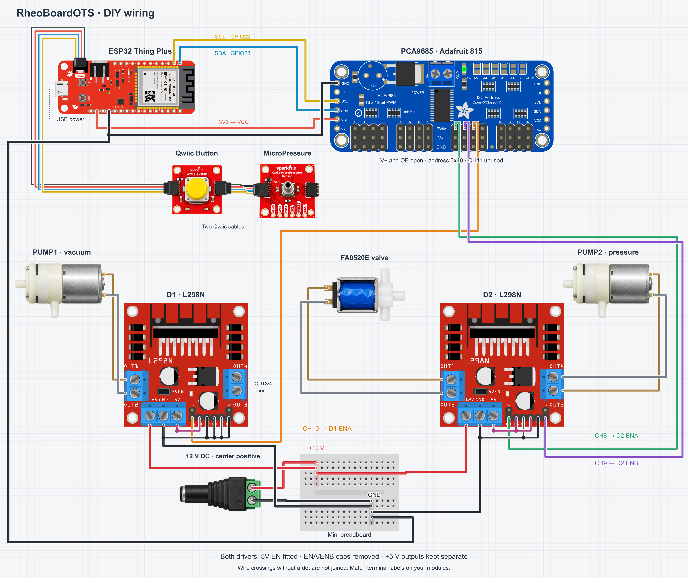
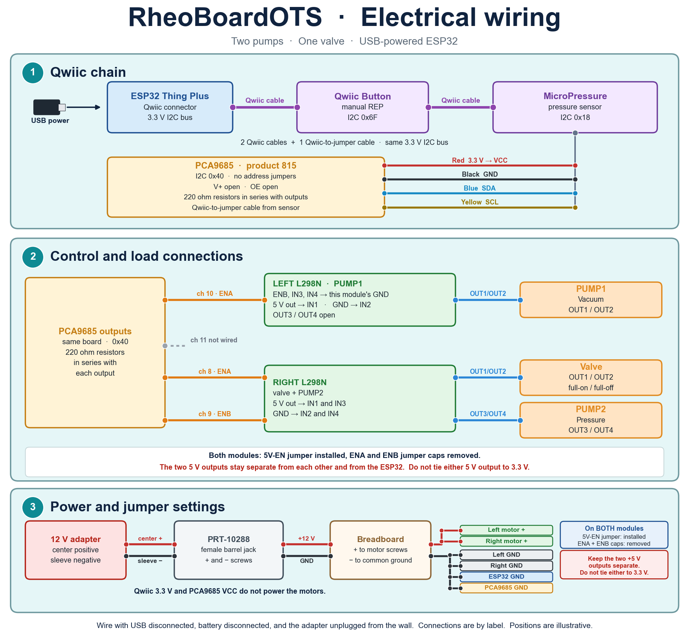

# Electronic wiring

This folder contains the electronic wiring diagrams for RheoBoardOTS - DIY. Step 02 of the [Assembly instructions](https://github.com/The-Hybrid-Atelier/RheoBoard/wiki/Assembly-instructions) page is the connection sequence.

**Component wiring**

[Full-size image](rheoboardots-fritzing.png) · [Editable SVG](rheoboardots-fritzing.svg)

**Connection reference**

The connection reference is `wiring-diagram.png`. `wiring_diagram.py` generates that three-section figure. `matplotlib` is required. Run `python3 wiring_diagram.py` from this folder. It writes `wiring-diagram.png`.

The figure shows the ESP32 Thing Plus, the PCA9685 (Adafruit product 815) on four header jumpers, two L298N modules, the pumps, and the valve. Two Qwiic cables join the ESP32, the Qwiic Button, and the MicroPressure sensor. The PCA9685 is not on that chain.

PCA9685 VCC comes from ESP32 3V3. GND is on the common ground. SDA is GPIO 23. SCL is GPIO 22. The address is `0x40`. There are no address jumpers. V+ and OE stay open. Product 815 has 220 ohm resistors in series with its outputs.

Channel 10 drives the left L298N ENA: PUMP1 on OUT1/OUT2. Channel 9 drives the right L298N ENB: PUMP2 on OUT3/OUT4. Channel 8 drives the right L298N ENA: the valve on OUT1/OUT2. Channel 11 is not wired. A finished REP leaves channel 8 full-on until the sketch releases it.

The channel defines are in [`PneumaticSystem.h`](../../../../code/firmware/RheoBoardOTS/PneumaticSystem.h).

Hookup-wire type and gauge are not stated. The wall-adapter connection to the L298N inputs is in [4. Connect the power wiring](https://github.com/The-Hybrid-Atelier/RheoBoard/wiki/Assembly-instructions#connect-the-power-wiring), and the continuity pairs and expected result are in [5. Check continuity](https://github.com/The-Hybrid-Atelier/RheoBoard/wiki/Assembly-instructions#check-continuity). A leak check and a photo of the finished wiring are not in this folder yet.

## Artwork credits

The component wiring illustration (`rheoboardots-fritzing.png` and `.svg`) is distributed under [CC BY-SA 4.0](https://creativecommons.org/licenses/by-sa/4.0/). It reuses the following component artwork:

| Artwork | Source and credit | Source license |
|---|---|---|
| ESP32 Thing Plus | [SparkFun Fritzing Parts](https://github.com/sparkfun/Fritzing_Parts/blob/main/products/14689_sfe_esp32_thing_plus.fzpz), SparkFun Electronics | [CC BY-SA 4.0](https://github.com/sparkfun/Fritzing_Parts/blob/main/License.md) |
| PCA9685, product 815 | [Adafruit Fritzing Library](https://github.com/adafruit/Fritzing-Library/blob/master/parts/Adafruit%2016-Channel%2012-bit%20PWM%20Servo%20Driver%20-%20I2C.fzpz), Adafruit Industries | [CC BY-SA 3.0](https://github.com/adafruit/Fritzing-Library/blob/master/README.md) |
| L298N module | [L298N motor-driver part](https://forum.fritzing.org/t/h-bridge-with-l298n-motor-driver-fixed-part-at-reply-33/7711/33), Florian Schäffer, modified by vanepp in August 2022 | Original Fritzing part attribution retained |
| Mini breadboard | [Fritzing parts library](https://github.com/fritzing/fritzing-parts/blob/develop/svg/core/breadboard/miniBreadboard.svg), Fritzing contributors | [CC BY-SA 3.0](https://github.com/fritzing/fritzing-parts/blob/develop/LICENSE.txt) |

Component artwork was arranged, scaled, and rotated; driver jumper caps, wiring, and labels were added for RheoBoardOTS. The button, sensor, pumps, valve, and barrel-adapter illustrations were generated from project reference photos and reused in the drawing. The SVG embeds the artwork and can be edited without external image files.

The connection-reference design and generator retain CERN-OHL-W-2.0 — see [`LICENSE`](../../../../LICENSE).
