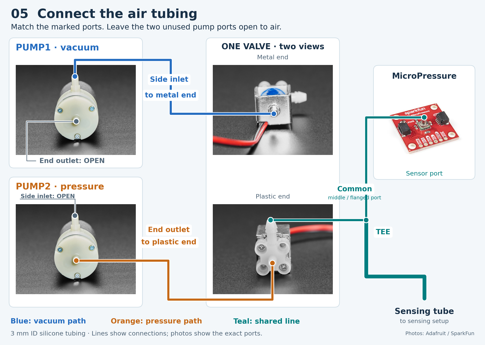

# Tube wiring

This folder is the pneumatic port table for RheoBoardOTS - DIY: two pumps, one switched-port valve, the pressure sensor, and the sensing tube. [Step 05: Connect tubing](https://github.com/The-Hybrid-Atelier/RheoBoard/wiki/Assembly-instructions#connect-tubing) summarizes these ports.

License: CERN-OHL-W-2.0 — see [`LICENSE`](../../../../LICENSE).

[Full-size figure](tube-connection.png) · [Editable SVG](tube-connection.svg)

The valve is shown from both ends to identify all three ports. Colored lines mark tube connections; gray leaders identify the pump ports left open. `python3 tubing_figure.py` regenerates both files using matplotlib and the component photos in `../../images/`.

Port identification follows the [Adafruit 4699 pump](https://www.adafruit.com/product/4699) and [Adafruit 4663 valve](https://www.adafruit.com/product/4663) descriptions. The valve common is the middle port with the flange. Embedded manufacturer photos retain their owners’ terms; photo sources are listed in [Images](../../images/README.md).

Tubing is Adafruit 4661, 1 m silicone, 3 mm ID, 5 mm OD, for air only. The length of each run is not stated. A tool to cut the silicone tubing is not named in the repository.

## Components

| Label | Part | Port usage |
|---|---|---|
| PUMP1 | Adafruit 4699 ZR370-02PM (vacuum) | **Side port** (inlet) → VALVE2 metal pole; **tubing port** (outlet) → atmosphere |
| PUMP2 | Adafruit 4699 ZR370-02PM (pressure) | **Tubing port** (outlet) → VALVE2 plastic pole; **side port** (inlet) → atmosphere |
| VALVE2 | Adafruit 4663 FA0520E | Metal pole (OFF) = vacuum path; plastic pole (ON) = pressure path; common → tee |
| Sensor | SparkFun Qwiic MicroPressure (MPRLS) | One tee branch |
| Sensing tube | Sensing tube | Other tee branch |

The valve common goes to the tee. One tee branch goes to the MicroPressure sensor. The other tee branch goes to the sensing tube. The FTLLB220-6005 fitting is optional on this path. The sensing setup CAD, using a GL45 bottle and a tube, is in [`Sensing Setup`](../../../../Sensing Setup/). The tee model is not stated.

### Pump note (4699)

The ZR370-02PM always draws air in through the **side port** and pushes it out the **tubing port**. Reversing motor wires does **not** flip flow direction — retract vs extrude is set by **which port is plumbed to the valve** and which is open to atmosphere, not by L298N direction wiring.

## Valve logic (VALVE2)

| VALVE2 state | PCA9685 channel 8 | Path |
|---|---|---|
| Full-off (suck / retract) | full-off | Common → metal pole (vacuum) → PUMP1 |
| Full-on (blow / extrude) | full-on | Common → plastic pole (pressure) → PUMP2 |

Idle pump not selected is disconnected through the valve — no plug or seal needed.

## Flow during a REP

A REP is described on [What is REP?](https://github.com/The-Hybrid-Atelier/RheoBoard/wiki/What-is-REP).

The tube paths change with the firmware phases:

1. **Baseline** — pumps off. The valve stays where the previous command left it. Boot leaves channel 8 full-off.
2. **Retract** — channel 8 full-off, PUMP1 on (vacuum, metal pole).
3. **Extrude** — channel 8 full-on, PUMP2 on (pressure, plastic pole). Factory ramp time is 0.
4. **Relax** — both pumps stop. Channel 8 stays full-on until the sketch releases it.

Timing, controls, and parameter defaults are on the [Firmware](https://github.com/The-Hybrid-Atelier/RheoBoard/wiki/Firmware) page.
