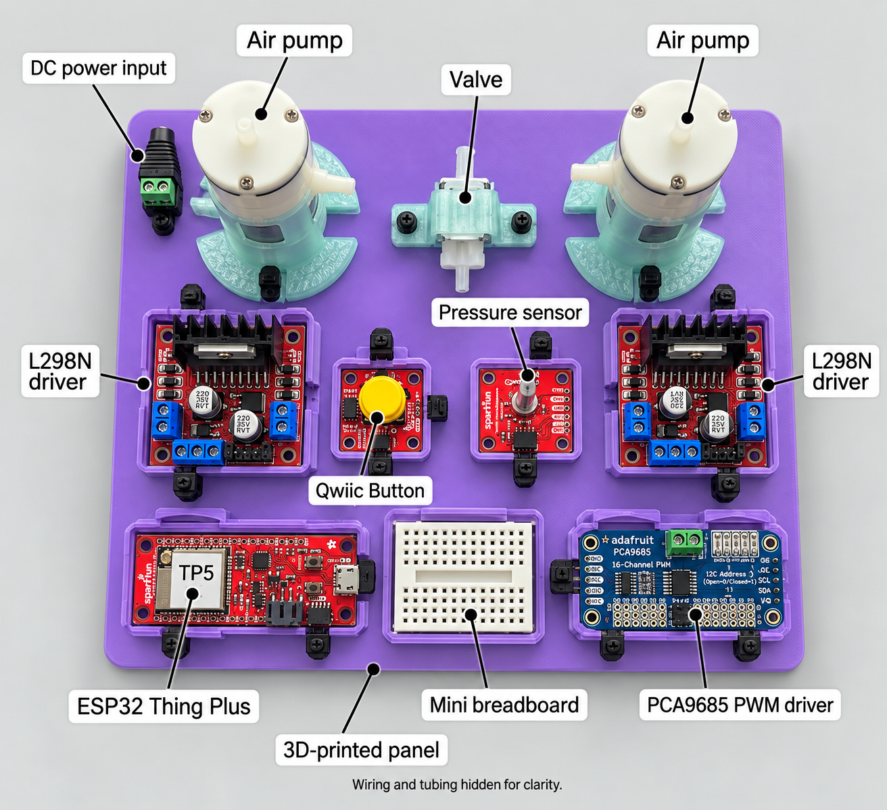

# Images

Project and component photos for RheoBoardOTS - DIY. These photos support the purchased parts on the [Parts to buy](https://github.com/The-Hybrid-Atelier/RheoBoard/wiki/Parts-to-buy) wiki page.

`teaser.jpg` is an earlier assembled bench prototype. `rheoboardots-built-panel.jpg` is the current built panel. The component photos are `esp32-thing-plus.jpg`, `qwiic-micropressure.jpg`, `qwiic-button.jpg`, `adafruit-4699-air-pump.jpg`, `adafruit-4663-air-valve.jpg`, `power-adapter-alt-1202.jpg`, and `l298n-motor-driver.jpg`. Vendor photos stay under their owners' terms and are here so a builder can recognize the part. There is no bare-board photo of Adafruit product 815 in this folder.

The RheoBoardOTS CAD pictures are here as well. `plate_two_L298N_top.png` is the drawing for this build. `plate_one_L298N_top.png` is the one-L298N drawing and is not the current layout. `ESP32_ThingPlus_tray_with_module.png`, `L298N_tray_with_module.png`, `MicroPressure_tray_with_module.png`, and `PCA9685_ServoDriver_tray_with_module.png` show each board in its tray. The print files stay in [`RheoBoardOTS_CAD`](../cad/RheoBoardOTS_CAD/).

`rheoboardots-labeled-overview.png` is the illustrated component overview, rendered from the built-panel reference with wiring and tubing hidden for clarity. Use the [assembly instructions](https://github.com/The-Hybrid-Atelier/RheoBoard/wiki/Assembly-instructions) for connections.
