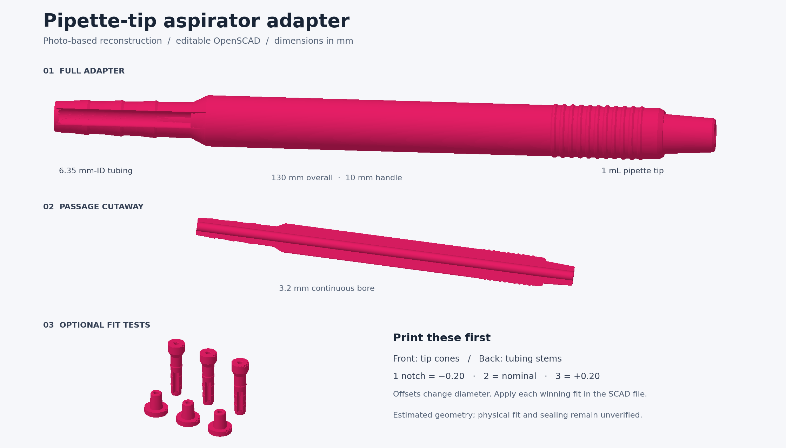

# Pipette-tip aspirator adapter

[Open the editable OpenSCAD file](aspirator_adapter.scad). It is self-contained and exports in millimetres. Select **adapter**, render with F6, and export STL at 100% scale. **section** is a cutaway for inspection only.

This is a photo-based reconstruction of the Fisher/AssayCell pen-shaped adapter. The 1 mL tip capacity and 6.35 mm tubing inner diameter are published specifications. The 130 mm overall length, 10 mm handle, grip rings, cone, hose stem, and 3.2 mm bore are adjustable estimates or design choices. No manufacturer drawing or measured original was available. Fit, sealing, and pressure response have not been physically verified.

## Fit first

Set `part = "fit_tests"`. This produces six separate coupons with through-holes. The front row has three pipette-tip cones; the back row has three tubing stems. Count the notches in each coupon's grip rim:

| Notches | Diameter change from current fit settings |
| --- | --- |
| 1 | -0.20 mm |
| 2 | 0.00 mm |
| 3 | +0.20 mm |

`fit_step` changes the 0.20 mm spacing. Add the winning offset to `tip_diameter_adjust` or `hose_diameter_adjust`, then return to **adapter**. Positive values make the connection larger/tighter; these are diameter changes, not radius changes. The test pieces share the full model's mating profiles. They test fit; the final full-length print still needs its own leak check.

Push the tip's wide opening over the small tapered male cone. The starting cone is 6.6 to 7.8 mm before its small end chamfer. This is a trial fit around a published 7.5 mm mouth on one brand of 1000 µL tip, not a universal pipette standard. If none fits, change the two cone diameters or length, rather than scaling the whole model. The 6.35 mm tubing size means its **inside** diameter; tubing fits over the opposite end's three shallow rings. Use flexible tubing that can stretch over them.

## PLA printing and use

Suggested starting settings for a 0.4 mm nozzle: 0.12–0.16 mm layers, at least four walls, 100% infill, and an external 8 mm brim. Print upright in the supplied orientation, tubing end on the bed and tip cone upward. The vertical bore and gradual shoulders are designed to print without internal supports. Check the slicer preview, keep the passage open, and remove the brim carefully from the lower tubing face. Print settings are starting points, not a tested recipe.

Confirm the bore is clear and test the full assembled adapter for air leakage before pressure measurements. The nominal straight passage adds about 1.05 mL of air volume; changing its size or length can affect a pneumatic measurement's response. Check with your actual setup. For liquid aspiration, use a suitable liquid trap between the adapter and the vacuum source and keep liquid away from the pressure sensor. Use non-filtered tips where liquid must flow through the tip into the adapter.

PLA is a prototype material here. The commercial product's autoclavability does not apply to this print. Airtightness, chemical compatibility, cleaning, and suitability for sterile work are unverified.

## References and reconstruction choices

- [Fisher NC2884357 / RSPNKDPT](https://www.fishersci.com/shop/products/pink-aspirator-adaptor/NC2884357): standard 1 mL tips and 1/4-inch-ID tubing.
- [AssayCell ACT-51003](https://assaycell.com/shop/laboratory_supplies/aspirators/aspirator-adapater-for-1-ml-pipette-tip/): pink and blue adapter photos. They show a long round handle, narrow male tip cone, finger-grip rings, and a shallow ribbed tubing stem. Photo proportions informed the outline, but perspective and missing scale prevent exact dimensions.
- [MIDSCI PR1MA tip dimensions](https://shop.midsci.com/item/ASPR1MABARR/PR1MA-Low-Retention-Graduated-Barrier-Pipette-Tips/): one 1000 µL tip is listed with a 7.5 mm top inner diameter. This supports a starting fit trial only; it does not specify this adapter or the user's unknown tips.
- [Thingiverse: 8 Channels vacuum aspirator, thing 1486294](https://www.thingiverse.com/thing:1486294): related aspiration design found during searches for “pipette adapter” and “aspirator”; not a matching single-tip handle. No mesh or source code from it is incorporated.
- [HYKYHT open-source aspiration system, HardwareX (2024)](https://pmc.ncbi.nlm.nih.gov/articles/PMC10848023/): related single/multichannel aspiration architecture and liquid-trap context. Its CAD was not copied.

The reconstruction uses shallow sloped ribs in place of uncertain molded detail and a straight open passage whose original diameter is unknown. No ejector, valve, or vent is added. All geometry in the SCAD file is newly authored.

Validation on 2026-10-12: all three modes rendered with OpenSCAD's WebAssembly engine. The full adapter exported as one closed manifold mesh with an open axial passage; the fit set exported as six separate closed manifold meshes. No mesh-edge or winding errors were found. The full model's bounds are 10.5 × 10.5 × 130 mm including grip rings. This validates CAD geometry, not printed-part sealing or compatibility.

License: hardware CERN-OHL-W-2.0 — see [LICENSE](../../../LICENSE). These notes are documentation under the repository's CC BY-SA 4.0 terms.
