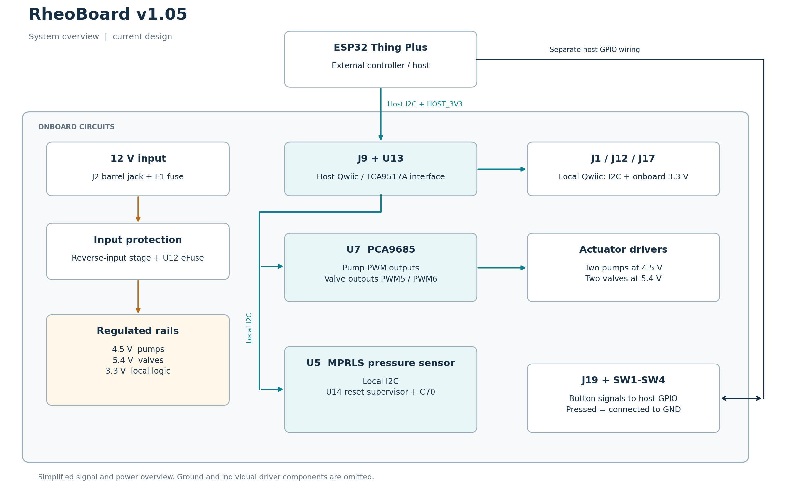
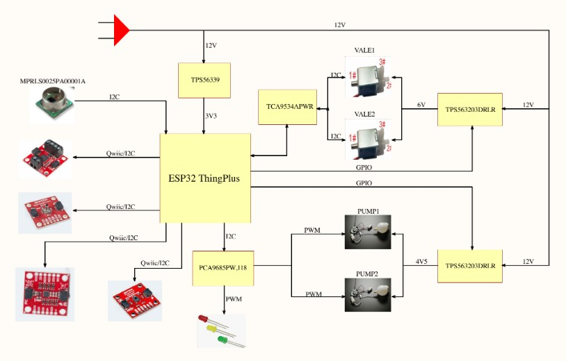

# RheoBoard PCB

## Current PCB — v2

The assembled and tested v2 board is marked `RheoBoard_V2`. Open the [v2 project in Altium Designer](RheoBoard_v2/Altium/RheoBoard_v2.PrjPcb).

[PCB layout](RheoBoard_v2/Altium/RheoBoard_v2.PcbDoc) · [Main schematic](RheoBoard_v2/Altium/MAIN.SchDoc) · [Power schematic](RheoBoard_v2/Altium/POWER.SchDoc) · [Parts library](RheoBoard_v2/Altium/RheoBoard_v2.IntLib) · [v2 file index](RheoBoard_v2/README.md)

[Complete v2 project ZIP](RheoBoard_v2/RheoBoard_v2-Altium.zip) · [Purchasing BOM (Excel)](RheoBoard_v2/BOM/BOM_RheoBoard_v2.xlsx) · [Gerbers, NC drills and board views](RheoBoard_v2/README.md#bare-board-artwork) · [STEP model and preview](RheoBoard_v2/README.md#3d-model)

For a bare-board order, use the [v2 JLCPCB upload ZIP and order settings](RheoBoard_v2/Manufacturing/JLCPCB/README.md).

## FA0520E valve holder

All RheoBoard PCB revisions and RheoBoardOTS DIY share this valve-holder design. Four low stops locate three sides of the metal valve frame and leave the plastic head open.

[SolidCraft 0.30.1 project](../mechanical/valve-holder/FA0520E-valve-holder.sc) · [STEP model](../mechanical/valve-holder/FA0520E-valve-holder.step) · [Printable STL](../mechanical/valve-holder/FA0520E-valve-holder.stl)

## Earlier revisions

- [v1.05](RheoBoard_v1.05/) — KiCad 10 project and manufacturing files.
- [Earlier Altium project](RheoBoard_v1-altium/RheoBoard_V1.PrjPcb) — v1 design snapshot.
- [v1](RheoBoard_v1/) — original KiCad project and outputs.
- [v0.05 Altium import](RheoBoard_v0.05-altium/) — historical imported design.

### v1.05 files

The v1.05 PCB uses a PCA9685 for pump and valve control, a nominal 5.4 V valve rail, J19 for host button inputs, and a reset supervisor for the MPRLS pressure sensor. The [RheoBoardOTS firmware](../code/firmware/README.md) targets the DIY controller. The v1.05 PCB requires its own actuator and button handling.

[Editable v1.05 diagram (SVG)](images/custom-pcb-block-diagram-v105.svg).

- [JLCPCB order folder](RheoBoard_v1.05/Manufacturing/JLCPCB/): matching fabrication ZIP, complete assembly BOM/CPL and ordering guide; 142 positions per board (137 surface-mount parts and five through-hole connectors), pumps U8/U11 excluded.
- [KiCad project](RheoBoard_v1.05/RheoBoard_v1.05/RheoBoard_v1.05.kicad_pro)
- [Schematic and board](RheoBoard_v1.05/RheoBoard_v1.05/)
- [Symbols](RheoBoard_v1.05/Symbol/), [footprints](RheoBoard_v1.05/Footprint/) and [3D models](RheoBoard_v1.05/3D/)
- [Full BOM workbook](RheoBoard_v1.05/BOM/BOM_RheoBoard_v1.05.xlsx) and [SMT-only BOM export](RheoBoard_v1.05/BOM/BOM_RheoBoard_v1.05_JLCPCB.csv)
- [Gerbers and drills](RheoBoard_v1.05/Manufacturing/Gerber/)
- [Fabrication ZIP](RheoBoard_v1.05/Manufacturing/RheoBoard_v1.05_fabrication.zip)
- [SMT-only placement CSV](RheoBoard_v1.05/Manufacturing/CPL/CPL_RheoBoard_v1.05_JLCPCB_SMT.csv) and [native position export](RheoBoard_v1.05/Manufacturing/CPL/RheoBoard_v1.05_native_positions.csv)
- [KiCad drawings](RheoBoard_v1.05/Manufacturing/Drawings/)

The external ESP32 controller, power supplies, valves, cables and tubing are separate purchases. See the [v1.05 wiki BOM](https://github.com/The-Hybrid-Atelier/RheoBoard/wiki/RheoBoard_v1.05-BOM) for the assembly scope and separate parts.

### System diagrams

The original v1 system overview shows the controller, sensor, pumps and valves.

Hardware license: CERN-OHL-W-2.0 — see [LICENSE](../LICENSE).
