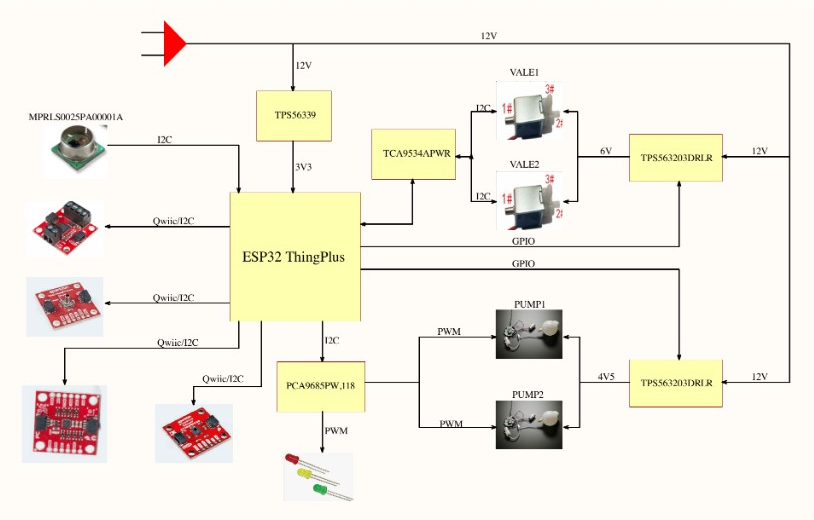
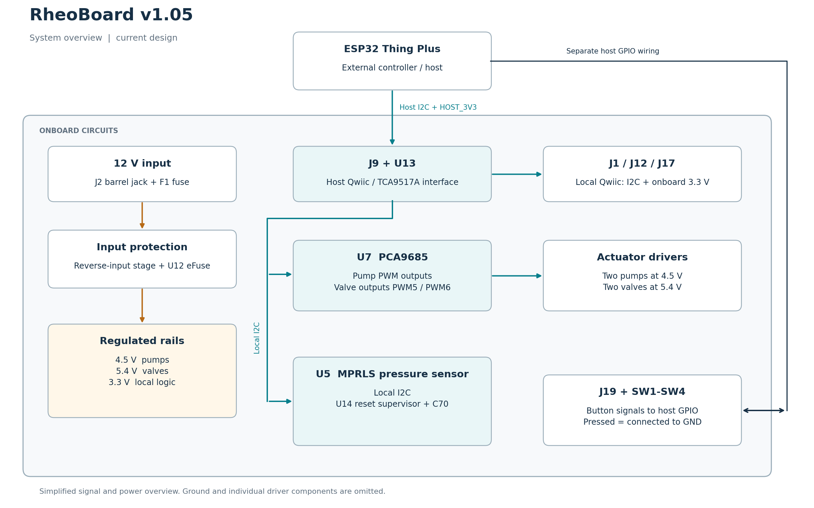

# RheoBoard PCB

- [v1.05](RheoBoard_v1.05/): current KiCad project and manufacturing files.
- [v1](RheoBoard_v1/): earlier native KiCad design and its outputs.
- [v0.05 Altium import](RheoBoard_v0.05-altium/): historical imported design.

v1.05 uses the PCA9685 for pump/valve control, a nominal 5.4 V valve rail, and a reset supervisor for the MPRLS sensor. The sketch in [firmware](../code/firmware/README.md) is the RheoBoardOTS DIY controller. It is not a ready-to-run v1.05 PCB driver: that board uses the PCA9685 for pump and valve outputs and J19 for host GPIO button inputs. PCB control and button handling must be implemented and verified for that hardware. Current circuit descriptions are on [PCB Design](https://github.com/The-Hybrid-Atelier/RheoBoard/wiki/PCB-Design).

## System diagrams

Both diagrams show the same overall RheoBoard system. The original illustrated overview is retained alongside the detailed v1.05 overview.

The original shows TCA9534 valve control and a 6 V valve rail. The v1.05 design below uses PCA9685 control for both pumps and valves and a nominal 5.4 V valve rail; use it and the current schematic for revision-specific connections.

[Editable v1.05 diagram (SVG)](images/custom-pcb-block-diagram-v105.svg).

## v1.05 files

- [KiCad project](RheoBoard_v1.05/RheoBoard_v1.05/RheoBoard_v1.05.kicad_pro)
- [Schematic and board](RheoBoard_v1.05/RheoBoard_v1.05/)
- [Symbols](RheoBoard_v1.05/Symbol/), [footprints](RheoBoard_v1.05/Footprint/) and [3D models](RheoBoard_v1.05/3D/)
- [BOM](RheoBoard_v1.05/BOM/)
- [Gerbers and drills](RheoBoard_v1.05/Manufacturing/Gerber/)
- [Fabrication ZIP](RheoBoard_v1.05/Manufacturing/RheoBoard_v1.05_fabrication.zip)
- [Placement files](RheoBoard_v1.05/Manufacturing/CPL/)
- [KiCad drawings](RheoBoard_v1.05/Manufacturing/Drawings/)

Hardware license: CERN-OHL-W-2.0 — see [LICENSE](../LICENSE).
