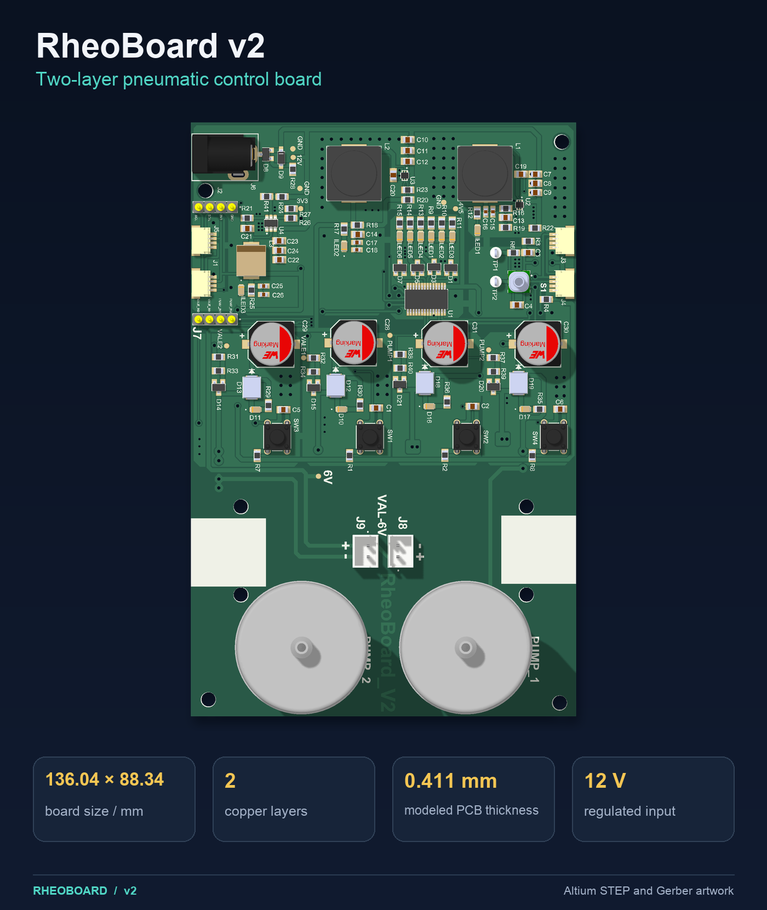
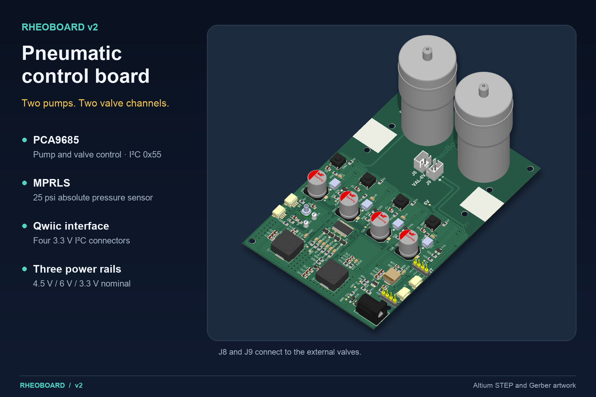
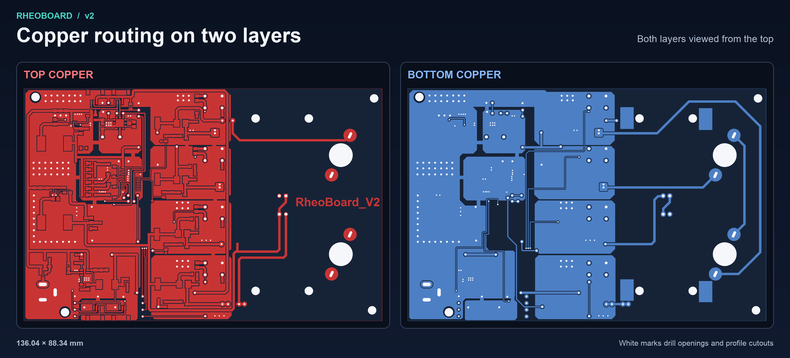
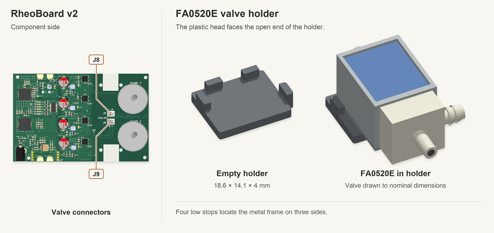
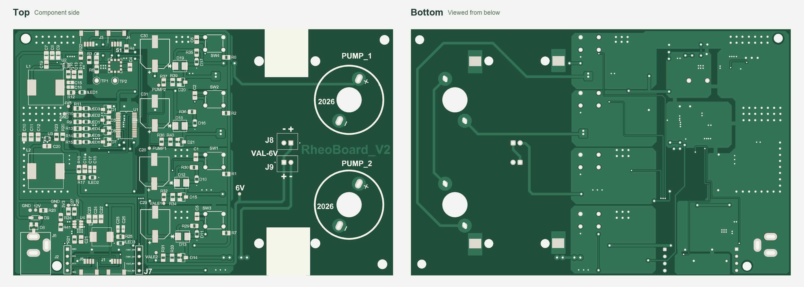
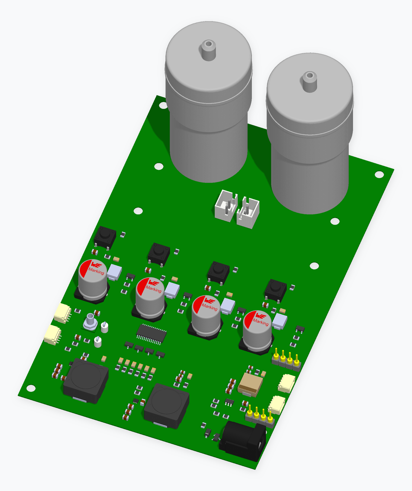

# RheoBoard v2 Altium design

Open [RheoBoard_v2.PrjPcb](Altium/RheoBoard_v2.PrjPcb) in Altium Designer. When copying the design, take the entire [Altium folder](Altium/) so the project can find its three schematics, PCB and parts library. The board is marked `RheoBoard_V2`.

| Design file | Contents |
| --- | --- |
| [MAIN.SchDoc](Altium/MAIN.SchDoc) | Controller interface, sensor and actuator circuits |
| [POWER.SchDoc](Altium/POWER.SchDoc) | Power supplies |
| [RheoBoard_v2.SchDoc](Altium/RheoBoard_v2.SchDoc) | System overview. Eight linked images are missing from the original delivery. |
| [RheoBoard_v2.PcbDoc](Altium/RheoBoard_v2.PcbDoc) | Two-layer board layout |
| [Purchasing BOM (Excel)](BOM/BOM_RheoBoard_v2.xlsx) | Component quantities, supplier part numbers and v1.05 parts that also fit v2 |

The [v2 parts library](Altium/RheoBoard_v2.IntLib) includes all 43 symbol types used in the schematics. The ZR370 pump, J8/J9 connector and 1 mm test point use footprints recovered from the v2 PCB. The off-board FA0520E valve uses a schematic symbol and connects through J8 or J9.

## Board illustrations

| Component-side overview | Angled assembly view |
| --- | --- |
|  |  |

| Top and bottom copper | FA0520E valve holder |
| --- | --- |
|  |  |

## Bare-board artwork

[Gerber layers](Manufacturing/Gerber/) · [Round-hole NC drill file](Manufacturing/NC-Drill/RheoBoard_V2-RoundHoles.TXT) · [Slotted-hole NC drill file](Manufacturing/NC-Drill/RheoBoard_V2-SlotHoles.TXT) · [Drill tool sizes and counts](Manufacturing/NC-Drill/RheoBoard_V2.DRR)

The top and bottom views use the supplied Altium Gerbers and both NC drill files. The two cream rectangles on the component side are part of the top silkscreen.

## 3D model

The board views show the two pumps and valve connectors J8 and J9. The [original STEP model](3D/RheoBoard_v2.step) also includes both external valves.

